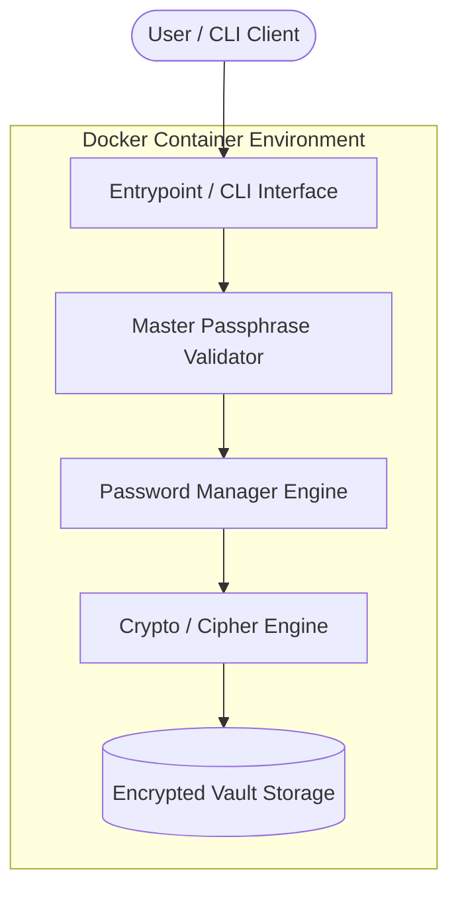

# PyPasswordManager

> A secure, containerized, and lightweight password management utility built for reliability and simplicity.

<p align="center">
  <a href="https://github.com/waters-im/PyPasswordManager"></a>
  <a href="https://github.com/waters-im/PyPasswordManager/blob/main/LICENSE"></a>
  <a href="https://github.com/waters-im/PyPasswordManager/stargazers"></a>
  <a href="https://github.com/waters-im/PyPasswordManager/network/members"></a>
  <a href="https://github.com/waters-im/PyPasswordManager/issues"></a>
  <a href="https://github.com/waters-im/PyPasswordManager/commits/main"></a>
  <a href="https://me.tlrd.ai/waters-im"></a>
</p>

<p align="center">
  
</p>

<p align="center">
  <a href="#-features">Features</a> •
  <a href="#-architecture">Architecture</a> •
  <a href="#-quick-start">Quick Start</a> •
  <a href="#-usage">Usage</a> •
  <a href="#-testing">Testing</a> •
  <a href="#-support--community">Support</a> •
  <a href="#-license">License</a>
</p>

---

## ✨ Features

- **Containerized Isolation**: Shipped with production-ready Docker support ensuring zero-friction, isolated deployment across any host.
- **Cryptographic Protection**: Secure credential handling designed with defensive storage boundaries and master passphrase integrity.
- **Stateless & Portable Execution**: Easily deployable inside container environments without persistent host clutter or configuration sprawl.
- **Minimal Dependency Surface**: Lean footprint engineered for rapid boot times, reproducible container builds, and minimal attack surface.
- **DevOps & CI/CD Ready**: Structured cleanly for automated image builds, validation pipelines, and repeatable operational maintenance.

---

## 🏛 Architecture



### Tech Stack Summary

| Layer | Technology |
| :--- | :--- |
| **Runtime & Language** | Python / Code execution runtime |
| **Containerization** | Docker (`Dockerfile`) |
| **Configuration & VCS** | Git, Environment Variables |
| **License** | MIT License |

---

## 🚀 Quick Start

### Prerequisites

- [Docker](https://www.docker.com/get-started) (v20.10 or later) OR [Python](https://www.python.org/) (v3.10 or later)
- [Git](https://git-scm.com/)

### 1. Clone the Repository

```bash
git clone https://github.com/waters-im/PyPasswordManager.git
cd PyPasswordManager
```

### 2. Run with Docker (Recommended)

Build and run the isolated container instance:

```bash
# Build the Docker image
docker build -t pypasswordmanager .

# Run the application interactively
docker run -it --rm pypasswordmanager
```

### 3. Alternative: Local Setup

```bash
# Create and activate virtual environment
python3 -m venv .venv
source .venv/bin/activate  # On Windows: .venv\Scripts\activate

# Run the application
python main.py
```

---

## 💻 Usage

Once launched, follow the interactive prompts or supply configuration parameters to manage credentials:

```bash
# Example interactive command execution
$ docker run -it --rm pypasswordmanager

[+] PyPasswordManager Initialized
[?] Enter master passphrase: ****************
[1] Store New Credential
[2] Retrieve Password
[3] Generate Secure Password
[4] Exit
```

---

## 🧪 Testing

Validate container builds and run test suites locally or within Docker:

```bash
# Test containerized build health
docker build --target test -t pypasswordmanager-test . || docker build -t pypasswordmanager .

# Run local test harness (if applicable)
python -m unittest discover -s tests
```

---

## 🤝 Support & Community

Contributions, issue reports, and suggestions are welcome!

- **Issue Tracker**: Submit bugs and feature requests via [GitHub Issues](https://github.com/waters-im/PyPasswordManager/issues).
- **Discussions & Feedback**: Reach out to the maintainer via [TLRD Profile](https://me.tlrd.ai/waters-im).

---

## 📄 License

This project is distributed under the terms of the MIT License. See [LICENSE](LICENSE) for full details.
